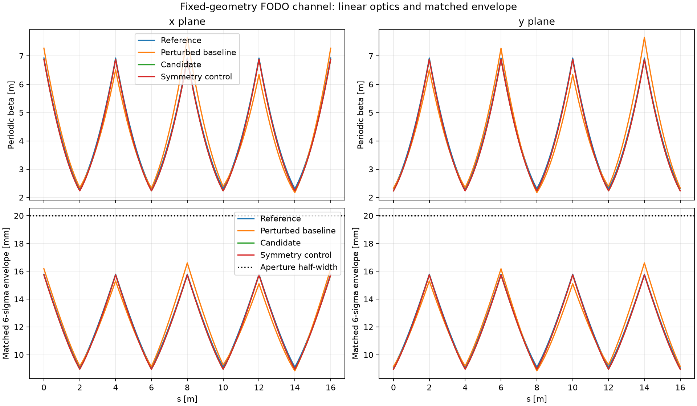

# Accelerator beam-optics Discovery@Home pilot

**Working local benchmark; author-checked, not independently reviewed.** The contributor
trial found useful, fast optimization improvements, but recommends this as an
**onboarding/demo pilot rather than a flagship discovery project yet**.
Read the [trial assessment](docs/ASSESSMENT.md) for the evidence and launch criteria.
No repository was published. No maintainer has agreed; donor intake is closed.

The benchmark compares fixed-geometry, bounded quadrupole settings with explicit tune,
chromaticity, stability, envelope and aperture constraints. Xsuite and a separate NumPy
transfer-matrix implementation independently recompute candidates. Negative tests reject
bad claims. Additional fixtures test irregular spacing and a fixed injected beam.



- Original search: peak beta **7.657629 → 6.885626 m** versus a perturbed baseline.
- Textbook reference: **6.928203 m**. A symmetry control reaches **6.883446 m** under
  the allowed tune/chromaticity budget, so the headline gain is mostly known recovery.
- Equivalent minimax reformulation: **45 evaluations** to reach the control score.
- Irregular fixture with fixed entrance optics: **10.822649 → 9.210605 m**, preserving
  its specified tune/chromaticity/optics gates; about **7.75% smaller matched width**.
- Fixed-injection tracking: **5.47% lower largest sampled RMS width** on average across
  three seeds, with the same incoming particles; about 5.57% with synthetic errors.
- Nominal tracking: **no transmission improvement**; all cases survived, and some
  optimized metrics are worse than the textbook reference. See the assessment.

[Why fixed injection matters](results/injection-tradeoff.png) ·
[Public demonstration](results/public-demo.png) · [Animation](results/public-demo.gif) ·
[Search history plot](results/search.png) · [Tracking plot](results/tracking.png)

## Reproduce

Tested with Python 3.13.0 on Apple M2, CPU only. Use a local environment and the pinned
lockfile. Linux is supported by Xsuite but was not tested in this trial.

```sh
python3.13 -m venv .venv
.venv/bin/python -m pip install -r requirements.lock
.venv/bin/python -m beamopt.verify --reference
.venv/bin/python -m pytest -q
.venv/bin/python -m beamopt.reproduce
```

A single check took about 8 seconds on a busy shared host; the complete retained-candidate
check is longer. Exact timings and package versions are in `results/trial/`.
Recompute all original searches, tracking, added controls and visualizations in a
fresh clone. This overwrites local generated results and refreshes author-checked
records; it does not constitute independent scientific acceptance:

```sh
bash run.sh
```

Run the added fixed-injection study using its committed fixture:

```sh
.venv/bin/python -m beamopt.epigraph --spec results/injection-spec.json --output results/trial/injection-search.json
.venv/bin/python -m beamopt.injection_study
```

Run just one independently checked candidate:

```sh
.venv/bin/python -m beamopt.verify results/analytic-candidate.json
.venv/bin/python -m beamopt.verify results/trial/epigraph-injection-7.json --spec results/injection-spec.json
```

The [model contract](docs/MODEL.md) states units, all limits and missing physics.
The [research brief](docs/BRIEF.md) cites the textbook reference; [AGENTS.md](AGENTS.md)
and [DISCOVERY.md](DISCOVERY.md) describe contribution/review rules. Results and seeds
are retained locally. Independent *implementations* are not independent human review.

`python protocol/discover.pyz validate .` reports the intentional missing-maintainer
schema issue. The pilot must obtain real maintainer consent before being listed;
a fictitious name is not substituted to make validation pass.
